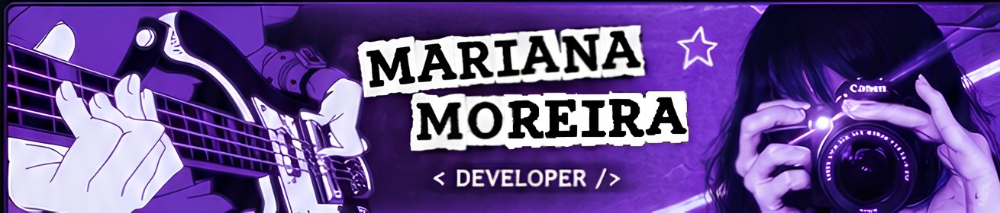
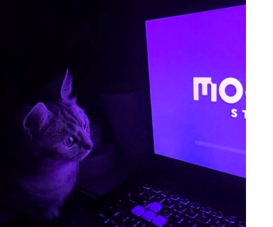
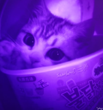
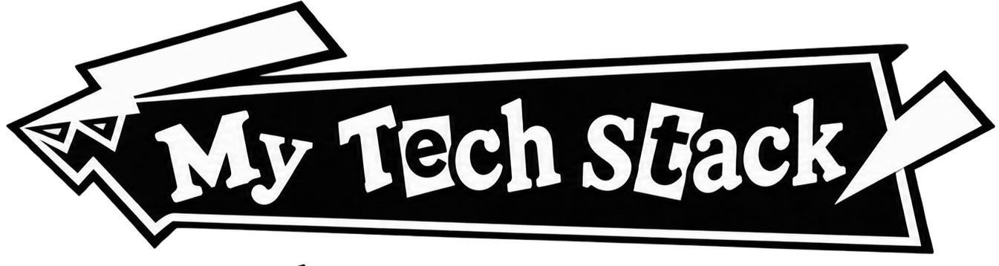

  

 

  
  &nbsp;
  
  &nbsp;
  

   
  <big><big><strong>Who Am I?</strong></big></big> 
  

<table align="center" width="100%">
  <tr>
    <td width="40%" align="center" valign="top">
      

  I'm <strong>Mariana Moreira</strong>, an <strong>Information Systems student</strong> at UNIFAFIBE and a graduate of a technical program in <strong>Systems Development</strong> at ETEC. I'm building my career in technology, with a special interest in <code>software development</code> and <code>technical support</code>.

  I enjoy turning what I learn into practice through personal projects and real-world problem solving. I work with technologies such as <strong>HTML</strong>, <strong>CSS</strong>, <strong>JavaScript</strong>, <strong>Python</strong>, <strong>PHP</strong>, <strong>SQL</strong>, <strong>Supabase</strong> and <strong>Firebase</strong>, and I use <code>Git / GitHub</code> to organize my projects.

  Some of the projects I have been developing include <strong>ZM Pratas</strong>, <strong>BATPAPO</strong>, and <strong>Busify</strong>. I also have hands-on experience in <strong>technical support</strong>, solving real problems involving systems, users, and equipment. My goal is to keep learning, improving, and building useful software.

 
    </td>
  </tr>
</table>

  <big><big><strong>You can Click here</strong></big></big> 
  
      
  &nbsp;
  

 
<table align="center">
  <tr>
    <td valign="top">
      
    </td>
    <td valign="middle">
       <strong>Note</strong>  
      <strong>Behind the Code</strong>  
      I’m constantly learning, creating, and turning ideas into something real. 
      Every project is a chance to learn something new and build something better.
    </td>
    <td width="30"></td>
    <td valign="middle">
      
    </td>
  </tr>
</table> 

  

<table align="center" width="100%">
  <tr>
    <td width="45%" valign="middle" align="center">
      
    </td>
    <td width="55%" valign="middle" align="center">
      
    </td>
  </tr>
</table>

  

